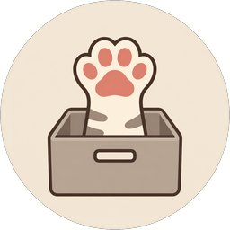

<div align="center">



# GatherBox Lite

**Build your own offline library of videos and articles.**

Bilibili downloads · Zhihu archives · Multiple accounts · Local reading

[简体中文](README.md) | [English](README.en.md)

[](LICENSE)
[](#download-and-install)
[](https://github.com/joelovechen/GatherBox_Lite/actions/workflows/build.yml)

[Downloads](https://github.com/joelovechen/GatherBox_Lite/releases) · [User guide](docs/usage.md) · [Development](docs/development.md) · [Issues](https://github.com/joelovechen/GatherBox_Lite/issues)

</div>

## Overview

GatherBox Lite is a Windows desktop application that brings Bilibili downloads and Zhihu offline reading into one interface. Manage accounts, organize followed creators, track download tasks, and save content you are authorized to access.

The current release target is **Windows x64**. Verified macOS and Linux release packages are not currently available.

## Features

| Feature | Description |
|---|---|
| Bilibili downloads | Parse video links, choose video and audio quality, download audio separately, and manage a task queue |
| Creators and collections | Manage followed creators and collections, and check for new content according to your settings |
| Zhihu archives | Save articles and answers, organize creators and favorites, and read locally |
| Multiple accounts | Switch accounts in the app, with data separated by platform and Zhihu account |
| Download controls | Choose output folders, concurrency, and request rates |
| Desktop interface | Light and dark themes, UI scaling, task status, and update notifications |

Content availability and media quality depend on platform responses and account permissions. The application does not unlock paid content.

## Download and install

Visit [Releases](https://github.com/joelovechen/GatherBox_Lite/releases) and read the notes for your chosen version.

| File | Usage |
|---|---|
| `GatherBox_Lite_v*_x64-setup.exe` | Installer: follow the setup wizard for regular use |
| `GatherBox_Lite_v*_win64_portable.zip` | Portable: extract the entire archive to a writable directory and run `GatherBoxLite.exe` |

**Microsoft Edge WebView2 Runtime** is required. The installer includes an online bootstrapper; portable users need the runtime installed separately. Keep the backend directory alongside the application rather than copying only the main EXE.

Releases labeled as tests are not production releases. A test tag may differ from the version embedded in its packages; consult the release notes.

## Getting started

1. Launch the app and add an account for the platform you want to use.
2. Add a content link or select creators, collections, or favorites.
3. Start a download or archive task and follow its progress in the task list.
4. Adjust output folders, concurrency, and request rates in Settings.

By default, application data is stored in `download/` beside the app. Media output folders can be configured separately. Close the app and back up your data before updating or migrating. See the [user guide](docs/usage.md) for details.

## Run from source

Required: Python 3.11, Node.js 22, pnpm, Rust stable, MSVC C++ Build Tools, Windows SDK, and WebView2 Runtime.

Run in PowerShell:

```powershell
git clone https://github.com/joelovechen/GatherBox_Lite.git
cd GatherBox_Lite
python -m venv dev/.venv
./dev/.venv/Scripts/python.exe -m pip install -r dev/BilibiliApis-master/requirements.txt
cd dev/bili-app
pnpm install --frozen-lockfile
pnpm tauri dev
```

The desktop host starts the local Python backend automatically. See the [development guide](docs/development.md) for builds, offline tests, and packaging.

## Documentation and layout

The detailed guides are currently in Simplified Chinese:

- [User guide](docs/usage.md): installation, updates, data storage, backups, and troubleshooting.
- [Development](docs/development.md): environment, builds, tests, and packaging.
- [FFmpeg](docs/ffmpeg.md): trimmed source, build instructions, and licensing.

```text
dev/bili-app/              Vue frontend and Tauri desktop host
dev/BilibiliApis-master/   Python local service, downloads, and archiving
scripts/                  Build, installation, and update scripts
tools/ffmpeg-minimal-src/  Trimmed FFmpeg source
docs/                     User and development documentation
```

## Feedback and contributions

[Issues](https://github.com/joelovechen/GatherBox_Lite/issues) and pull requests are welcome. Include the application version, Windows version, reproduction steps, and sanitized error details. Describe the purpose of your changes and the checks you actually ran in your PR.

Do not upload cookies, tokens, account databases, private archives, or logs containing them. Platform interfaces may change; reduce request rates and follow platform instructions when you encounter rate limits or verification prompts.

## License and usage

GatherBox Lite application code is licensed under the [MIT License](LICENSE). The files in `tools/ffmpeg-minimal-src/` retain FFmpeg's own licenses and copyright notices and are not covered by the root MIT license. See the [FFmpeg guide](docs/ffmpeg.md).

Only save content you are authorized to access, copy, and use, and follow the relevant platform rules. This project is not officially affiliated with Bilibili or Zhihu.
